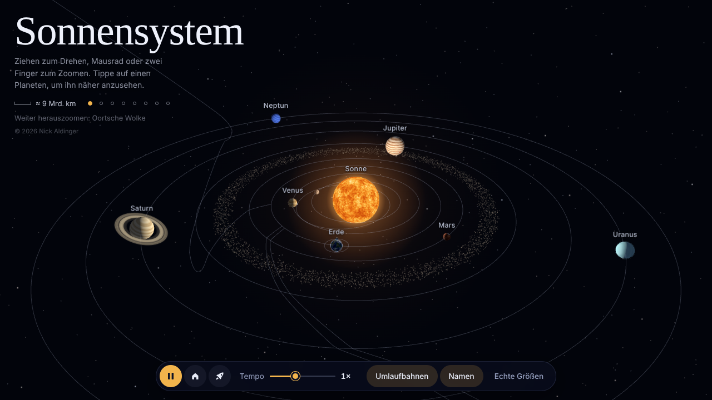
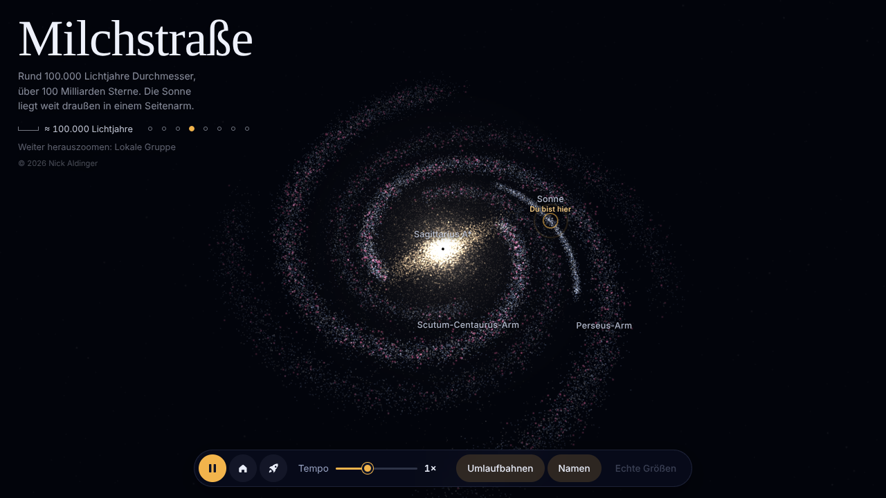
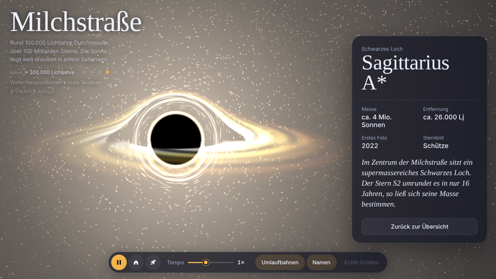
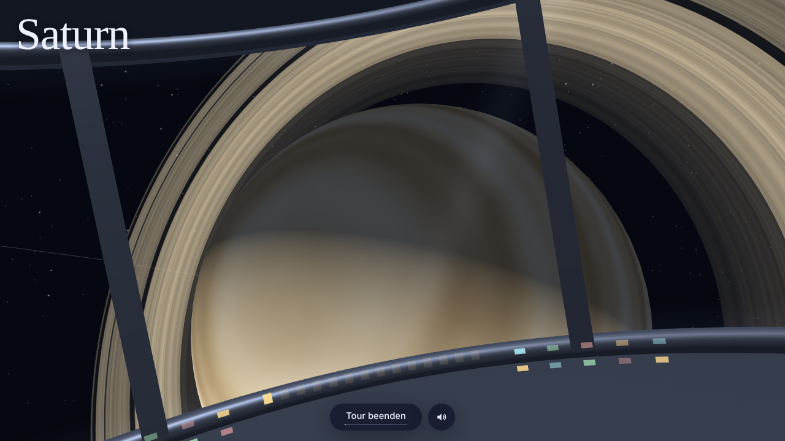

# Kosmos 3D

**An interactive 3D journey from Earth to the multiverse, right in your browser.**

Start with the planets circling the Sun, then keep zooming out: past the Oort cloud, the neighbouring stars, the Milky Way and its central black hole, the Local Group, the Laniakea supercluster and the cosmic web, until you reach a sea of bubble universes. Or sit back in the rocket capsule and let a three-minute guided tour fly you all the way.



**Live demo:** https://nicks2d.github.io/kosmos-3d/

**Author:** Nick Aldinger ([@nicks2d](https://github.com/nicks2d))

> The interface is in German.

## Features

### The solar system
- The Sun and all eight planets with their own orbital periods, axial tilts and rotation, plus the Moon, Saturn's rings and the asteroid belt
- Click any planet to fly to it and follow it along its orbit, with an info card showing key facts
- **True sizes mode:** the Sun and planets shown in their real size ratio
- **Spacecraft:** the ISS, the James Webb Space Telescope, Parker Solar Probe, New Horizons, Voyager 1 and Voyager 2, each as a small 3D model with its trajectory and an info card
- Shooting stars drift across the background

### Eight levels of scale
Zoom past the edge of one level and the next one fades in around it. Zooming in always brings you back home.

| Level | What you see |
|---|---|
| Solar system | Planets, moons, spacecraft |
| Oort cloud | Kuiper belt, Pluto, Eris, Haumea, Makemake, Sedna, the heliopause, comets with tails |
| Solar neighbourhood | Alpha Centauri, Sirius, Barnard's Star, Vega and more |
| Milky Way | Spiral arms, the galactic bar, "You are here" |
| Local Group | Andromeda, the Triangulum Galaxy, the Magellanic Clouds |
| Laniakea | Galaxy streams flowing towards the Great Attractor |
| Observable universe | The cosmic web and the cosmic microwave background |
| Multiverse | Bubble universes, clearly marked as a hypothesis |



### Sagittarius A\*
Fly up to the black hole at the centre of the Milky Way to see its shadow, the glowing accretion disk and gravitational lensing that bends the light of the stars behind it.



### Guided rocket tour
A three-minute first-person flight from Earth to the multiverse, seen from inside a capsule with a 360° window front, a glowing console and a speed gauge.

- Passes the ISS, the Moon, Mars, Jupiter and Saturn, Voyager 1 and the edge of the heliosphere
- Flies through a comet shower in the Oort cloud
- Slowly circles the black hole and the Andromeda Galaxy
- Stars streak past as light trails at high speed
- Drag to look around; the view eases back when you let go
- Engine rumble, rushing noise and comets whooshing past, all synthesised live with the Web Audio API (can be muted)



## Controls

| Action | Mouse | Touch |
|---|---|---|
| Rotate the view | Drag | Drag with one finger |
| Zoom | Scroll wheel | Pinch |
| Select an object | Click | Tap |
| Back to the overview | `Esc` or "Zurück zur Übersicht" | "Zurück zur Übersicht" |

The bottom bar lets you pause, change the simulation speed (0.1× to 50×), toggle orbits and names, switch to true sizes, jump back to the start (house icon) and launch the rocket tour (rocket icon). The dots in the top left jump straight to any level.

## Running it locally

Everything lives in a single file with no build step. Open `index.html` in a modern browser, or serve the folder:

```bash
python3 -m http.server 8000
# then open http://localhost:8000
```

An internet connection is needed, because Three.js and the fonts load from a CDN.

## How it's built

- **[Three.js](https://threejs.org/) r128** with OrbitControls for the 3D scene
- **Procedural textures:** every planet, moon and the Sun are generated in the browser with noise functions, so there are no image files
- **Custom GLSL shaders** for atmospheres, the black hole's accretion disk and lensing, the cosmic microwave background, the bubble universes and comet tails
- **Separate scenes for each level of scale**, blended with logarithmic zoom transitions to avoid floating-point precision problems across 26 orders of magnitude
- **Web Audio API** for the synthesised flight sounds
- Responsive layout for desktop and mobile, light and dark mode, and support for the system's "reduce motion" setting

## Accuracy notes

- Planet sizes and distances are scaled for visibility unless true sizes mode is on. Distances are always compressed.
- The Oort cloud level is compressed logarithmically, because it spans from 30 to about 100,000 AU.
- Spacecraft positions and figures reflect October 2026. Voyager 1 reaches one light-day from Earth on 18 November 2026.
- The cosmic web is a simplified illustration, not a map of real galaxy positions.
- The multiverse is a thought experiment. There is no observational evidence for other universes.

## Made by

**Nick Aldinger** ([@nicks2d](https://github.com/nicks2d)) came up with the idea and directed the project: what to build, how it should look and feel, every new feature, testing and feedback.

The code was written with **[Claude](https://claude.ai)** by Anthropic as an AI pair programmer. Nick described each feature in plain language, Claude wrote, tested and refined the code, and the two iterated until it worked the way he wanted.

### Tools and connectors used

| Tool | What it was used for |
|---|---|
| [Claude](https://claude.ai) (Anthropic) | Writing, debugging and refining all of the code from Nick's prompts |
| Claude Artifacts | Publishing the page as a live preview after every change |
| Web Search | Up-to-date spacecraft data, such as Voyager 1's distance and Parker Solar Probe's orbit |
| GitHub connector | Uploading and maintaining this repository |
| Claude memory | Keeping track of the project across separate chats |
| Obsidian (via the Claude desktop app) | Project notes and a development log in Nick's Obsidian vault |
| Playwright + Chromium | Automated test runs and the screenshots in this README |

## Credits

- [Three.js](https://github.com/mrdoob/three.js) (MIT License)
- Fonts: [Hanken Grotesk](https://fonts.google.com/specimen/Hanken+Grotesk) and [Instrument Serif](https://fonts.google.com/specimen/Instrument+Serif) (SIL Open Font License)
- Astronomical data from NASA, JPL and ESA public sources

## License

Copyright © 2026 Nick Aldinger. All rights reserved.

This project is published for viewing and demonstration only. You may not copy, modify or redistribute the code without written permission. See [LICENSE](LICENSE) for details.
